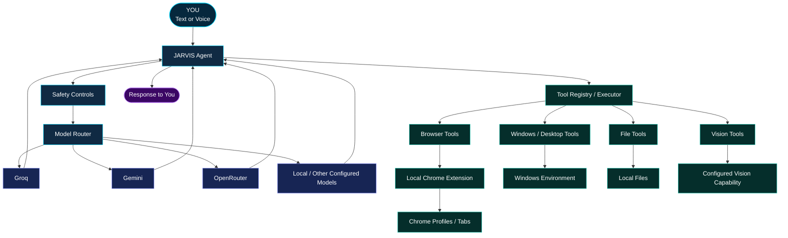
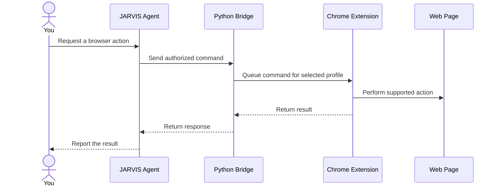

# ⚡ J.A.R.V.I.S. — Personal AI Assistant

<div align="center">

<!-- Replace this banner with a real animated GIF in your repository, e.g. assets/jarvis-core.gif -->
<!-- Recommended visual: a glowing cyan AI core, rotating holographic rings, and a robotic HUD. -->

# `J.A.R.V.I.S.`

### JUST A RATHER VERY INTELLIGENT SYSTEM

**A personal AI assistant built to think, speak, connect, and act.**

[](https://www.python.org/)
[](https://www.microsoft.com/windows)
[](#-the-intelligence-core)
[](#-what-jarvis-can-do)
[](#-license)

**[Explore the Architecture](#-inside-the-jarvis-system) · [Installation](#-installation) · [Configuration](#-configure-your-ai) · [Troubleshooting](#-troubleshooting)**

</div>

---

> *"The goal isn't just to build an AI that answers questions. It's to build an assistant that can help you get things done."*

---

## ◉ SYSTEM BOOT SEQUENCE

```text
┌─────────────────────────────────────────────────────────────┐
│                    J.A.R.V.I.S. CORE                        │
├─────────────────────────────────────────────────────────────┤
│  [01] INITIALIZING       Python runtime                      │
│  [02] LOADING            Configuration and safety controls   │
│  [03] CONNECTING         Available AI model providers         │
│  [04] REGISTERING        Tools and automation capabilities  │
│  [05] ACTIVATING         Voice and browser components        │
├─────────────────────────────────────────────────────────────┤
│  STATUS: Follow the setup instructions to launch your system │
└─────────────────────────────────────────────────────────────┘
```

**Mission:** create a modular personal AI assistant that combines language models, voice interaction, browser automation, and Windows tools in one extensible Python project.

This is an evolving personal project—not a claim that every feature works on every machine without configuration.

## 🛰️ WHAT IS JARVIS?

JARVIS is a Windows-focused personal AI assistant designed around a simple idea:

**Understand the request → choose an appropriate capability → perform the action → return the result.**

Instead of relying on a single AI provider or keeping every capability inside one enormous Python file, the project separates the agent, model routing, tools, browser integration, voice components, and safety controls.

The long-term vision is a more capable desktop assistant that can work across applications while remaining understandable, configurable, and under the user's control.

## ✦ WHAT JARVIS CAN DO

<table>
<tr>
<td width="50%" valign="top">

### 🧠 AI INTELLIGENCE

- Integrate multiple AI model providers.
- Route requests through the model layer.
- Keep provider configuration separate from agent logic.
- Develop fallback behavior for provider failures.

</td>
<td width="50%" valign="top">

### 🎙️ VOICE INTERACTION

- Work with speech-related components.
- Integrate speech recognition and voice routing.
- Configure a wake-word workflow.
- Explore more natural hands-free interaction.

</td>
</tr>
<tr>
<td width="50%" valign="top">

### 🌐 BROWSER CONTROL

- Communicate with a local Chrome extension.
- Inspect tabs and active-page information.
- Navigate to pages.
- Support registered browser actions such as clicking, filling, and reading page content.

</td>
<td width="50%" valign="top">

### 🖥️ DESKTOP AUTOMATION

- Organize Windows automation tools.
- Provide a foundation for controlled desktop actions.
- Separate tool execution from language-model reasoning.
- Extend capabilities through modular tool files.

</td>
</tr>
<tr>
<td width="50%" valign="top">

### 🧩 MODULAR ARCHITECTURE

- Dedicated model router.
- Tool registry and executor.
- Configuration and safety modules.
- Separate browser and voice components.

</td>
<td width="50%" valign="top">

### 🔐 LOCAL-FIRST CONTROL

- Keep API credentials in local environment configuration.
- Run the browser bridge on loopback.
- Use explicit safety controls.
- Keep private configuration out of version control.

</td>
</tr>
</table>

> **Capability note:** the presence of a module does not guarantee that its dependencies, API credentials, browser extension, and local configuration are already working. Follow the setup steps and test each subsystem on your machine.

---

## 🧠 INSIDE THE JARVIS SYSTEM

### The architecture at a glance



### The six major layers

<details>
<summary><strong>01 — The Agent: the coordinator</strong></summary>

The agent receives a request, uses the configured model layer, and coordinates the next step.

Its job is to connect the user's intent to the capabilities available in the project. It should not need to contain the implementation of every browser, file, and desktop operation itself.

**Primary file:** `agent.py`

</details>

<details>
<summary><strong>02 — Model routing: the intelligence layer</strong></summary>

The model router provides a centralized place to configure and call supported AI providers.

Potential providers in this project include Groq, Gemini, OpenRouter, and a local or OpenAI-compatible endpoint, depending on the current configuration.

A multi-provider design makes it easier to change models without redesigning the entire assistant. Fallback is only available when the relevant providers, credentials, and error-handling paths are configured correctly.

**Primary file:** `models/router.py`

</details>

<details>
<summary><strong>03 — Safety controls: the guard layer</strong></summary>

The safety modules provide a place to define and enforce restrictions around agent behavior and tool execution.

Automation should remain bounded by explicit permissions. Browser or desktop actions can have real consequences, so review the configured safety rules before enabling new tools.

**Files:** `safety_config.py`, `safety_guard.py`

</details>

<details>
<summary><strong>04 — Tools: the action layer</strong></summary>

Tools translate supported agent requests into operations.

The project separates capabilities into dedicated modules, including browser, file, computer, vision, and Windows automation tools. The registry and executor provide a central integration point.

**Directory:** `tools/`

</details>

<details>
<summary><strong>05 — Browser Bridge: the connection layer</strong></summary>

The browser extension and Python bridge communicate through a local HTTP service.



Relevant files:

- `tools/chrome_bridge.py`
- `browser_extension/background.js`
- `browser_extension/content.js`
- `browser_extension/config.js`
- `browser_extension/popup.js`

The extension must be installed and enabled in the intended Chrome profile. The Python bridge and extension must use the same private bridge token.

</details>

<details>
<summary><strong>06 — Voice: the interaction layer</strong></summary>

Voice components are separated from the main agent so speech-related functionality can evolve independently.

Relevant files include `voice/stt.py`, `voice/voice_router.py`, and `voice/wake_word.py`.

Actual behavior depends on installed packages, local audio hardware, model files, and configuration.

</details>

---

## ⚙️ PROJECT STRUCTURE

```text
JARVIS1/
│
├── main.py                    # Main application entry point
├── app.py                     # Additional application interface
├── agent.py                   # Agent coordination
├── config.py                  # Environment and provider configuration
├── safety_config.py           # Safety configuration
├── safety_guard.py            # Safety enforcement
│
├── models/
│   └── router.py              # Model-provider routing
│
├── tools/
│   ├── registry.py             # Tool registration
│   ├── executor.py             # Tool execution
│   ├── basic_tools.py          # Basic utilities
│   ├── browser_tools.py        # Browser operations
│   ├── chrome_bridge.py        # Local extension bridge
│   ├── computer_control.py     # Computer control
│   ├── computer_tools.py       # Computer-related tools
│   ├── file_tools.py            # File operations
│   ├── vision_tools.py          # Vision-related tools
│   └── windows_automation.py   # Windows automation
│
├── browser_extension/
│   ├── manifest.json
│   ├── background.js
│   ├── content.js
│   ├── config.js
│   ├── popup.html
│   └── popup.js
│
├── voice/
│   ├── stt.py
│   ├── voice_router.py
│   ├── wake_word.py
│   └── models/                 # Optional local voice model files
│
├── requirements.txt
├── requirements-jarvis.txt
├── .env.example
├── .gitignore
└── README.md
```

The exact contents may evolve as the project develops.

---

## 🚀 INSTALLATION

### Prerequisites

Before starting, make sure you have:

- Windows 10 or Windows 11.
- Python 3.12 recommended for this development setup.
- Git.
- Google Chrome for browser integration.
- Internet access for cloud AI providers.
- API credentials for whichever providers you choose to use.
- A microphone and supported audio dependencies if using voice input.

### Step 1 — Get the project

```powershell
git clone https://github.com/armaankhantech/JARVIS-Personal-AI-Assistant.git
cd JARVIS-Personal-AI-Assistant
```

### Step 2 — Create a Python environment

```powershell
py -3.12 -m venv .venv
```

Activate it:

```powershell
.\.venv\Scripts\Activate.ps1
```

If PowerShell blocks activation, run this in the current terminal session:

```powershell
Set-ExecutionPolicy -Scope Process -ExecutionPolicy RemoteSigned
.\.venv\Scripts\Activate.ps1
```

### Step 3 — Install dependencies

Start with the main dependency file:

```powershell
python -m pip install --upgrade pip
pip install -r requirements.txt
```

The repository also contains `requirements-jarvis.txt`. Review that file before installing it, as dependency lists can overlap or differ. Install additional dependencies only if your chosen features require them.

> If installation fails, check the error message and your Python version before installing random packages or changing the project environment.

---

## 🔑 CONFIGURE YOUR AI

### Step 4 — Create your private environment file

```powershell
Copy-Item .env.example .env
```

Open `.env` in VS Code and add your own credentials for the providers you intend to use.

Example configuration:

```dotenv
GROQ_API_KEY=
GEMINI_API_KEY=
OPENROUTER_API_KEY=

# Optional OpenAI-compatible local service
FREELLMAPI_API_KEY=
FREELLMAPI_BASE_URL=http://127.0.0.1:31415/v1

# Voice configuration
EDGE_TTS_VOICE=en-GB-RyanNeural

# Wake-word configuration
JARVIS_WAKE_WORD=1
JARVIS_WAKE_THRESHOLD=0.55

# Optional workspace configuration
JARVIS_WORKSPACE=D:\Jarvis
```

These are configuration examples, not credentials. Fill only the variables supported by the current code and the providers you intend to use.

**Never commit `.env`, API keys, passwords, or private bridge tokens to GitHub.** The `.env.example` file should contain placeholders only.

### Step 5 — Verify provider configuration

Check that the configuration module reads your environment variables:

```powershell
Get-Content .\config.py
```

Confirm that:

- Credentials are loaded from environment variables.
- The provider names match the variables in `.env`.
- The chosen provider has a valid API key.
- The configured model names are supported by that provider.
- Any local endpoint is running before you try to use it.

Do not paste your private `.env` contents into an issue, screenshot, or public discussion.

---

## 🌐 CONNECT THE CHROME EXTENSION

### Step 6 — Configure the private bridge token

The browser extension and Python bridge must use **the same locally configured secret**.

1. Generate a new, unpredictable token for your local installation.
2. Store it in your private `.env` file as `JARVIS_BRIDGE_TOKEN`.
3. Configure the extension's local token value using the mechanism expected by its current code.
4. Never commit the actual token to GitHub.
5. If a token was previously exposed, retire it and use a new one.

The Python bridge uses port `31419` on `127.0.0.1`. Keep it bound to loopback and do not expose it publicly.

### Step 7 — Load the extension

1. Open Chrome.
2. Visit `chrome://extensions`.
3. Turn on **Developer mode**.
4. Select **Load unpacked**.
5. Choose the project's `browser_extension` directory.
6. Open the Jarvis extension popup.
7. Select the Chrome profile you want to control.

The extension must be configured for the same profile that the Python command targets. If the extension is not running in that profile, browser commands may time out.

> The token is a security credential, not a feature flag. A matching token is necessary for authenticated communication, but it does not by itself guarantee that every browser action will work.

---

## ▶️ LAUNCH JARVIS

### Step 8 — Start the assistant

With your environment activated and configuration ready:

```powershell
python main.py
```

Use the prompt displayed by the application to enter a supported request.

If your current code exposes a separate application interface, inspect `app.py` and its documented startup instructions before launching it. Do not assume that every file in the repository is an independent application.

### Step 9 — Test one subsystem at a time

Try this sequence:

1. **Model:** send a simple question and verify that the configured provider responds.
2. **Fallback:** test the fallback path only after the primary provider works.
3. **Tools:** check a simple, low-risk tool operation.
4. **Browser:** verify the bridge status and read the active tab.
5. **Voice:** check speech recognition and output independently.
6. **Desktop:** test a harmless, explicitly permitted action before attempting complex automation.

This makes errors easier to diagnose than testing every subsystem at once.

---

## 🧪 TESTING & DEBUGGING

The repository includes test scripts such as:

```powershell
python test_models.py
python test_router.py
python test_fallback.py
python test_tools.py
python test_browser.py
```

Run a test only after reviewing what it does. Some scripts may make API calls, require credentials, or interact with your local browser.

### Common issues

<details>
<summary><strong>Model provider fails</strong></summary>

- Check that the required environment variable is set.
- Confirm the API key is valid without printing it to the terminal.
- Verify model availability and provider limits.
- Check network connectivity and the error returned by the provider.

</details>

<details>
<summary><strong>Chrome bridge times out</strong></summary>

- Make sure the bridge process is running.
- Check that the extension is enabled.
- Confirm the selected Chrome profile.
- Confirm that both sides use the same private token.
- Verify that port `31419` is not being used by another process.

</details>

<details>
<summary><strong>Voice input does not work</strong></summary>

- Check microphone permissions.
- Confirm required speech packages are installed.
- Check whether the configured voice model files exist.
- Run the relevant voice test separately.

</details>

<details>
<summary><strong>PowerShell cannot activate the environment</strong></summary>

Run the process-scoped execution policy command shown in the installation section, then activate the virtual environment again.

</details>

---

## 🔐 SECURITY DESIGN

Personal automation deserves careful boundaries.

- **Secrets:** keep API credentials and local tokens in private configuration.
- **Git:** ignore `.env`, virtual environments, and generated files.
- **Bridge:** use loopback networking and authenticated requests.
- **Tools:** retain explicit safety checks for sensitive actions.
- **Desktop access:** avoid granting unnecessary permissions.
- **Logs:** do not record API keys, passwords, or other secrets.
- **Public repository:** inspect staged files before each commit.

If a credential is accidentally committed, removing it from the latest version is not enough. Revoke or rotate the credential first, then review the repository history and clean it up as necessary.

---

## 🛠️ DEVELOPMENT ROADMAP

The following are possible future directions, not promises that these features already exist.

- [ ] Animated JARVIS-style desktop interface.
- [ ] Real-time audio visualization.
- [ ] More resilient model routing and fallback.
- [ ] Better voice interruption and response latency.
- [ ] Expanded browser workflows with explicit permissions.
- [ ] More reliable Windows application control.
- [ ] Improved diagnostics and structured logging.
- [ ] Automated tests for tool permissions and bridge authentication.
- [ ] Easier first-run setup and configuration validation.

---

## 🤝 CONTRIBUTING

Contributions, bug reports, and suggestions are welcome.

1. Fork the repository.
2. Create a focused branch.
3. Make one change at a time.
4. Test the affected subsystem.
5. Ensure no secrets or local files are included.
6. Open a pull request describing the change and how it was tested.

For bugs, include the relevant error message and the steps to reproduce it. Never include private API keys or bridge tokens.

---

## 👨‍💻 ABOUT THE BUILDER

<div align="center">

### Built by Armaan Khan

**Computer Science Graduate · AI Automation Builder · Developer**

I am building practical AI systems to learn how language models, tool calling, automation, and software architecture fit together in real applications.

JARVIS is part of that journey: an evolving personal AI assistant built through experimentation, debugging, integration, and continuous improvement.

[](https://github.com/armaankhantech)
[](https://www.linkedin.com/in/armaankhan-tech/)
[](https://x.com/armaankhantech)

**Learn. Build. Automate. Repeat.**

</div>

---

## 📜 LICENSE

No license has been specified in this README draft. Add a license file and update this section before presenting the project as open source with particular reuse permissions.

---

<div align="center">

### `J.A.R.V.I.S. // END OF TRANSMISSION`

*An assistant is not built in one commit. It is built one capability at a time.*

**If you find the project interesting, explore the code, follow the development journey, and share constructive feedback.**

</div>
