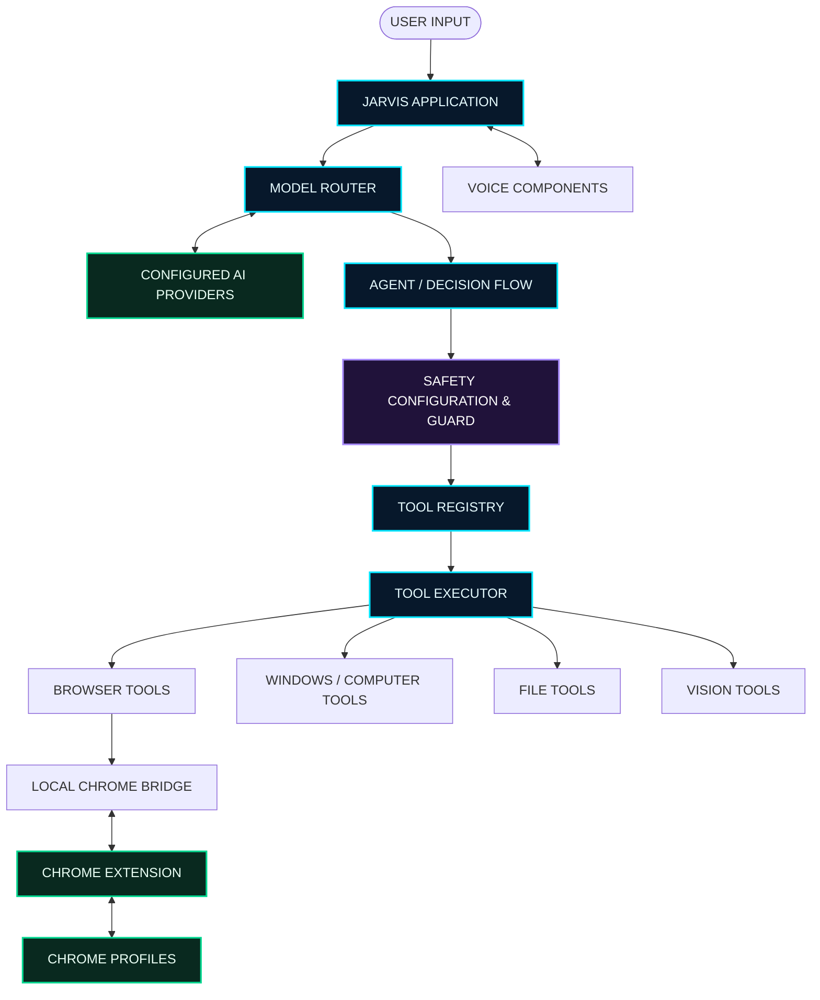
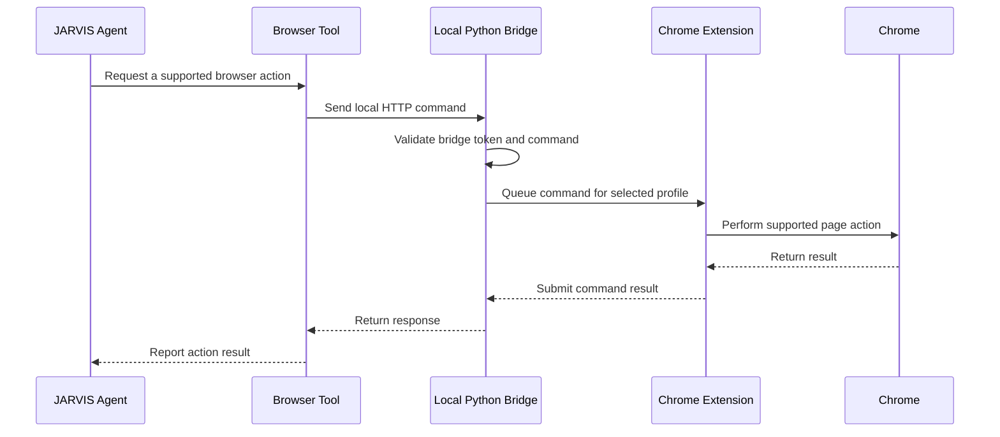

# ◈ J.A.R.V.I.S. — Personal AI Assistant

<p align="center">
  
  
  
  
</p>

<p align="center">
  <strong>YOUR DESKTOP. YOUR WORKFLOWS. YOUR PERSONAL AI.</strong>
  <br />
  An AI assistant designed to bring language models, voice interaction, browser automation, and Windows desktop capabilities into one personal system.
</p>

<p align="center">
  <a href="#-system-overview">System Overview</a> •
  <a href="#-features">Features</a> •
  <a href="#-installation">Installation</a> •
  <a href="#-configuration">Configuration</a> •
  <a href="#-usage">Usage</a> •
  <a href="#-about-the-builder">About the Builder</a>
</p>

---

```text
┌─────────────────────────────────────────────────────────────────────┐
│                                                                     │
│   J.A.R.V.I.S. // PERSONAL INTELLIGENCE SYSTEM                      │
│   ───────────────────────────────────────────────────────────────   │
│                                                                     │
│   > INITIALIZING PERSONAL AI                                        │
│   > LOADING MODEL ROUTER                                            │
│   > CONNECTING VOICE INTERFACE                                      │
│   > PREPARING BROWSER BRIDGE                                        │
│   > REGISTERING TOOLS                                               │
│                                                                     │
│   SYSTEM DESIGN: MODULAR                                            │
│   EXECUTION: TOOL-DRIVEN                                            │
│   CONFIGURATION: ENVIRONMENT-BASED                                  │
│                                                                     │
│   "The goal isn't just to build an AI that answers.                 │
│    It's to build an AI that can help you get things done."          │
│                                                                     │
└─────────────────────────────────────────────────────────────────────┘
```

> **Project vision:** Move beyond a chatbot that only responds with text. JARVIS is a personal AI assistant project exploring how models, tools, voice, browser control, and desktop automation can work together in a single system.

## ◈ System overview

JARVIS is a Python-based personal AI assistant built around a modular architecture. Instead of tying the entire application to one model or one capability, the project separates model routing, tools, voice components, browser communication, and safety controls into dedicated modules.

The goal is to make the assistant easier to extend, troubleshoot, and improve over time.

### What makes this project interesting?

- **Multi-provider AI:** a model-routing layer designed to work with configured AI providers.
- **Tool-driven execution:** dedicated modules for registering and executing assistant tools.
- **Voice capabilities:** speech-related components for a more natural interaction experience.
- **Browser integration:** a Chrome extension and local Python bridge for supported browser operations.
- **Windows automation:** dedicated modules for computer control and Windows-related workflows.
- **Safety-conscious design:** separate safety configuration and guard modules.
- **Modular development:** distinct components make it easier to add capabilities without rebuilding the entire application.

JARVIS is a personal development project, not a claim of a fully autonomous or unrestricted system. Available actions depend on the implemented tools, local configuration, connected providers, and permissions.

## ✦ Features

| Capability | What it contributes |
|---|---|
| AI model routing | Routes requests through the configured model-provider layer |
| Provider fallback experiments | Supports development and testing of alternative provider paths |
| Tool registry and executor | Organizes assistant tools and their execution |
| Browser extension | Connects the assistant to supported browser actions |
| Chrome bridge | Provides local communication between Python and the extension |
| Chrome profile selection | Supports the configured `work`, `main`, and `n8n` profiles |
| Browser actions | Includes operations such as reading pages, navigating, clicking, filling fields, and interacting with supported video controls |
| Voice components | Provides speech-related modules and voice routing |
| Wake-word component | Provides a dedicated component for wake-word functionality |
| Windows automation | Separates desktop and Windows automation functionality |
| File tools | Provides a dedicated module for file-related operations |
| Vision tools | Provides a dedicated module for vision-related capabilities |
| Safety controls | Separates safety rules from other assistant functionality |

Feature availability depends on configuration and the specific implementation of each module.

## ⌘ Architecture

The design separates the assistant into layers so that each component has a clear responsibility.



### Architecture explained

**1. Application layer — `main.py` and `app.py`**

The project entry points provide the starting points for running the assistant and its application interface. The exact entry point depends on the workflow you want to launch.

**2. Agent layer — `agent.py`**

The agent coordinates the assistant's decision flow and interactions with the available tools and model layer.

**3. Model layer — `models/router.py`**

The model router centralizes provider-related logic. This separation makes it easier to manage different model services and develop fallback behavior without placing all provider logic inside the application entry point.

**4. Safety layer — `safety_config.py` and `safety_guard.py`**

These modules separate safety-related configuration and checks from other application functionality. Keep this layer enabled and review it whenever you add new tools.

**5. Tool layer — `tools/`**

The tools package separates individual capabilities into modules, including browser operations, file handling, computer control, Windows automation, and vision-related functionality.

**6. Browser communication layer — `browser_extension/` and `tools/chrome_bridge.py`**

The extension communicates with the local Python bridge. The bridge uses a local HTTP endpoint and a token-based request check to support communication with the extension.

**7. Voice layer — `voice/`**

Voice-related modules handle the speech and wake-word portions of the project. Exact capabilities depend on the configured dependencies, voice models, and implementation.

## ◈ Repository structure

```text
JARVIS-Personal-AI-Assistant/
│
├── main.py                    # Main assistant entry point
├── app.py                     # Application interface
├── agent.py                   # Agent orchestration
├── config.py                  # Configuration and environment loading
│
├── models/
│   └── router.py              # Model-provider routing
│
├── tools/
│   ├── registry.py            # Tool registration
│   ├── executor.py            # Tool execution
│   ├── basic_tools.py         # Basic utility tools
│   ├── browser_tools.py       # Browser-related operations
│   ├── chrome_bridge.py       # Local extension bridge
│   ├── computer_control.py    # Computer-control functions
│   ├── computer_tools.py      # Computer tools
│   ├── file_tools.py          # File-related operations
│   ├── vision_tools.py        # Vision-related operations
│   └── windows_automation.py  # Windows automation
│
├── browser_extension/
│   ├── manifest.json          # Chrome extension manifest
│   ├── background.js          # Background extension logic
│   ├── content.js             # Page interaction logic
│   ├── config.js              # Local extension configuration
│   ├── popup.html             # Extension popup interface
│   ├── popup.js               # Popup behavior
│   └── offscreen.js           # Offscreen extension logic
│
├── voice/
│   ├── stt.py                 # Speech-related functionality
│   ├── voice_router.py        # Voice routing
│   ├── wake_word.py           # Wake-word functionality
│   └── models/                # Voice model metadata
│
├── safety_config.py           # Safety settings
├── safety_guard.py            # Safety checks
├── requirements.txt           # Python dependencies
├── requirements-jarvis.txt    # Project-specific dependency list
├── .env.example               # Example environment configuration
└── README.md                  # Project documentation
```

The tree above highlights the main components. Additional files in the repository support testing, configuration, and development.

---

# ⚡ Installation

## Prerequisites

Before installing JARVIS, prepare the following:

- Windows 10 or Windows 11
- Python 3.12 recommended
- Git
- Google Chrome, if you want to use browser integration
- A terminal such as PowerShell
- API credentials for whichever external model providers you choose to configure

Some functionality may require additional system dependencies or provider accounts.

### 1. Clone the repository

Open PowerShell and run:

```powershell
git clone https://github.com/armaankhantech/JARVIS-Personal-AI-Assistant.git
cd JARVIS-Personal-AI-Assistant
```

### 2. Create a virtual environment

```powershell
py -3.12 -m venv .venv
```

Activate it:

```powershell
.\.venv\Scripts\Activate.ps1
```

If PowerShell blocks activation for the current terminal, use:

```powershell
Set-ExecutionPolicy -Scope Process -ExecutionPolicy RemoteSigned
.\.venv\Scripts\Activate.ps1
```

This changes the execution policy for the current PowerShell process only.

You should see `(.venv)` at the beginning of your terminal prompt.

### 3. Upgrade pip

```powershell
python -m pip install --upgrade pip
```

### 4. Install dependencies

Start with the dependency file that matches the project setup:

```powershell
pip install -r requirements-jarvis.txt
```

If your checked-in `requirements.txt` is the maintained dependency list for your version, use that file instead. Avoid installing both lists blindly if they overlap or specify different versions.

If a dependency fails to install, check its Python-version requirements and the error message before changing package versions.

### 5. Configure environment variables

Create your private `.env` file from the example:

```powershell
Copy-Item .env.example .env
```

Open `.env` in your editor and add the credentials and settings you actually use.

**Never commit `.env` or paste API keys into issues, screenshots, or public documentation.**

---

# ⚙️ Configuration

The `.env.example` file documents the configuration variables intended for this project. The following examples describe the purpose of the variables; use the names and settings in your checked-out version as the source of truth.

| Variable | Purpose |
|---|---|
| `GROQ_API_KEY` | Credentials for the Groq provider |
| `GEMINI_API_KEY` | Credentials for the Gemini provider |
| `OPENROUTER_API_KEY` | Credentials for OpenRouter |
| `FREELLMAPI_API_KEY` | Credentials for a configured FreeLLMAPI service, if used |
| `FREELLMAPI_BASE_URL` | Base URL for that service |
| `EDGE_TTS_VOICE` | Voice selection for Edge TTS integration |
| `JARVIS_WAKE_WORD` | Wake-word feature configuration |
| `JARVIS_WAKE_THRESHOLD` | Wake-word detection threshold |
| `JARVIS_WORKSPACE` | Workspace path used by the application, where supported |
| `JARVIS_BRIDGE_TOKEN` | Private token for the local browser bridge |

### Example `.env`

```dotenv
GROQ_API_KEY=
GEMINI_API_KEY=
OPENROUTER_API_KEY=
FREELLMAPI_API_KEY=
FREELLMAPI_BASE_URL=http://127.0.0.1:31415/v1

EDGE_TTS_VOICE=en-GB-RyanNeural

JARVIS_WAKE_WORD=1
JARVIS_WAKE_THRESHOLD=0.55
JARVIS_WORKSPACE=D:\\Jarvis

JARVIS_BRIDGE_TOKEN=
```

This is an example only. Populate the credentials you use and keep the actual values private. Do not assume that every provider is enabled or available simply because a variable exists.

### Model-provider setup

JARVIS includes a model-routing module. To use a provider:

1. Obtain an API key from the provider you intend to use.
2. Place it in your local `.env` file under the correct variable.
3. Confirm the model and endpoint expected by your current router implementation.
4. Run the relevant model test script.
5. Test the assistant with a simple request before testing tool execution.

Provider names, free-tier limits, supported models, and endpoint availability can change. Consult the provider's current documentation if authentication or model requests fail.

---

# 🌐 Chrome browser integration

The browser integration connects the Python assistant to a Chrome extension through a local bridge.

## How the bridge works



The bridge is intended to bind to localhost (`127.0.0.1`) rather than act as a public web service. Keep it local and do not expose the bridge port to the internet.

## Load the Chrome extension

1. Open Google Chrome.
2. Navigate to `chrome://extensions`.
3. Enable **Developer mode**.
4. Select **Load unpacked**.
5. Choose the `browser_extension` folder inside the cloned repository.
6. Pin the extension if you want convenient access to its popup.
7. Select the intended browser profile in the extension, if prompted.

Repeat the loading process for each Chrome profile where you intend to use the extension.

## Configure the bridge token securely

The extension and Python bridge must use the same private token.

1. Generate a new random token for your local setup.
2. Put it in your private `.env` as `JARVIS_BRIDGE_TOKEN`.
3. Configure the local extension with the same value.
4. Ensure the Python process loads `.env` before the bridge module starts.
5. Restart the Python application and reload the extension after configuration changes.
6. Confirm the extension and bridge can communicate.

The committed `browser_extension/config.js` may contain a placeholder. **Replace that placeholder only in your local configuration. Never commit your private token.** If your local extension configuration is stored in a tracked file, restore the public placeholder before committing or use a separate ignored local configuration mechanism supported by your extension code.

A missing token should be treated as a configuration error. Do not work around authentication by removing the bridge's token check.

## Supported browser operations

The bridge's current command allowlist includes operations such as:

- Listing tabs and reading the active tab
- Navigating to a URL
- Clicking supported page elements
- Filling supported fields
- Pressing keys
- Reading page content
- Finding and interacting with supported elements
- Clicking the first matching video
- Seeking within supported video controls

Results depend on the extension being enabled in the correct profile, the active page, page structure, and the permissions available to the extension.

---

# ▶️ Usage

## Start JARVIS

From the repository root, activate your virtual environment and run:

```powershell
python main.py
```

If your workflow uses the application interface instead, follow the entry point and run instructions in the current source code.

### Try a simple request first

Start with a basic question that does not require browser or desktop actions. Confirm that the model provider is configured and returning a response.

Then test one tool at a time, beginning with a low-risk operation such as reading a supported page or opening a known website.

### Browser workflow

A typical browser workflow looks like this:

1. Start JARVIS.
2. Ensure the Chrome extension is loaded.
3. Confirm the selected Chrome profile.
4. Confirm that the local bridge is running.
5. Ask JARVIS to perform a supported browser operation.
6. Check the returned result rather than assuming the action succeeded.

### Voice workflow

Voice-related modules live under `voice/`. Configure the dependencies, voice selection, and wake-word settings for your environment. Test voice input and output independently before relying on a full voice-driven workflow.

### Desktop workflow

Windows and computer-control functionality is separated into dedicated tool modules. Use only supported operations, review any action that modifies files or settings, and test new automation with low-risk targets first.

---

# 🛡️ Safety and privacy

Personal assistants can access sensitive information and trigger real actions. Security is part of the design, not an optional feature.

- Keep API keys and private tokens in `.env` or another suitable secret store.
- Never commit `.env`, credentials, session cookies, passwords, or private configuration.
- Keep the browser bridge bound to localhost.
- Preserve bridge authentication and command validation.
- Do not disable the safety guard to make a tool work.
- Review file operations before allowing them to modify important data.
- Use least privilege for browser and desktop automation.
- Avoid exposing private browser profiles or sensitive page contents in logs.
- Rotate any token that may have been disclosed.
- Test tool changes before using them in important workflows.

JARVIS is a development project. Its safety modules do not guarantee that every model response or automated action is safe or correct. Review consequential actions yourself.

## Secret-handling checklist

Before every push:

```powershell
git status
git diff --cached --name-only
git diff --cached --check
git check-ignore .env
git check-ignore .venv
```

Verify that private credentials, virtual environments, and local-only files are not staged.

A `.gitignore` file prevents many accidental additions, but it does not remove a secret that has already been committed. If a real credential enters Git history, revoke or rotate it and assess the history before publishing.

---

# 🧪 Testing and development

The repository contains scripts for exercising model providers, fallback behavior, browser integration, and tool functionality.

Examples of the test files included in the repository:

```powershell
python test_models.py
python test_fallback.py
python test_router.py
python test_tools.py
python test_browser.py
```

Some tests may require valid provider credentials, a running local service, Chrome, or a configured extension. Run them in the environment required by each test.

These commands identify the test scripts present in the repository; they are not a claim that every test passes in every environment.

## Adding a new tool

A useful development workflow is:

1. Define the tool's responsibility and expected inputs.
2. Implement it in the appropriate module under `tools/`.
3. Register it using the project's existing registry conventions.
4. Validate its inputs and expected outputs.
5. Add appropriate safety checks.
6. Test success, failure, and invalid-input cases.
7. Confirm the agent can invoke the tool through the existing execution flow.
8. Update the documentation.

Prefer small, isolated changes. Avoid granting a new tool broader access than it needs.

---

# 🧰 Troubleshooting

<details>
<summary><strong>Python cannot find a module</strong></summary>

Activate the correct virtual environment and install the project's dependencies:

```powershell
.\.venv\Scripts\Activate.ps1
python -m pip install -r requirements-jarvis.txt
```

If the error persists, check which Python executable is active:

```powershell
python --version
where.exe python
```

Use the dependency file appropriate for your checked-out version.
</details>

<details>
<summary><strong>An AI provider returns an authentication error</strong></summary>

- Confirm that the correct environment-variable name is used.
- Ensure `.env` is located where the application's environment loader expects it.
- Restart the application after changing `.env`.
- Verify that the API key is valid and the selected model is available.
- Never paste your key into an issue or terminal screenshot.
</details>

<details>
<summary><strong>The browser bridge reports an error</strong></summary>

- Confirm the Python application loaded the correct environment configuration.
- Ensure `JARVIS_BRIDGE_TOKEN` is set.
- Check that the extension and bridge use the same private token.
- Confirm that the extension is enabled in the intended Chrome profile.
- Reload the extension after local configuration changes.
- Ensure the local bridge port is not already occupied by another process.
- Review the returned error and application logs.
</details>

<details>
<summary><strong>The bridge reports a timeout</strong></summary>

A timeout may mean the extension is not polling the correct profile, the page action is taking too long, the extension is disabled, or the active page does not support the requested action.

Check the profile selector, extension status, and target page before retrying.
</details>

<details>
<summary><strong>Voice input or wake-word detection does not work</strong></summary>

- Verify that the required voice dependencies are installed.
- Check microphone permissions and Windows audio input settings.
- Confirm the configured voice model and its associated metadata are available.
- Review wake-word configuration and threshold settings.
- Test speech-related components independently to isolate the problem.
</details>

<details>
<summary><strong>A browser action does not affect the expected element</strong></summary>

Page structure can change. Confirm that the target page is loaded, the expected element exists, and the extension has permission to interact with it. Avoid assuming that a successful request automatically means a successful page action.
</details>

---

# 🗺️ Roadmap

The long-term direction is to make JARVIS more useful, reliable, and easier to operate.

- [x] Modular Python project structure
- [x] Model routing module
- [x] Tool registry and execution modules
- [x] Chrome extension and local bridge components
- [x] Voice-related components
- [x] Dedicated safety modules
- [ ] More robust provider health checks and fallback observability
- [ ] Improved diagnostics and actionable error reporting
- [ ] Better extension configuration without tracked local secrets
- [ ] More comprehensive automated tests
- [ ] A polished animated desktop interface
- [ ] More reliable voice interaction and status feedback
- [ ] Improved documentation and contributor onboarding

The roadmap describes development goals, not guaranteed delivery dates.

---

# 🤝 Contributing

Ideas, bug reports, and improvements are welcome.

When proposing a change:

1. Explain the problem it solves.
2. Keep the change focused.
3. Avoid committing secrets or personal configuration.
4. Include reproduction steps for bugs.
5. Add tests where practical.
6. Update the README if behavior or setup changes.

For substantial changes, open an issue or discussion first so the proposed design can be reviewed.

## License

Choose and add a license file before describing this repository as open source under a specific license. Until a license is added, do not assume that others have permission to reuse, redistribute, or modify the project.

---

# 👨‍💻 About the builder

## Armaan Khan

**Computer Science graduate · AI automation builder · Personal AI systems developer**

I'm Armaan Khan, a computer science graduate interested in AI automation, practical AI systems, and building tools that connect language models to real workflows.

My focus is on learning by building: understanding how models work, connecting APIs, designing tool-driven agents, integrating browser automation, and making systems more useful through iterative development.

JARVIS represents that approach. It is an ongoing effort to explore how a personal AI assistant can combine reasoning, tools, voice interaction, browser integration, and desktop capabilities into one modular project.

**What I'm working toward:**

- AI automation and workflow engineering
- Tool-using agents and model integration
- Browser and desktop automation
- Practical, safety-conscious AI applications
- Building in public and documenting the learning process

### Connect with me

- **LinkedIn:** [linkedin.com/in/armaankhan-tech](https://www.linkedin.com/in/armaankhan-tech/)
- **GitHub:** [@armaankhantech](https://github.com/armaankhantech)
- **X:** [@armaankhantech](https://x.com/armaankhantech)

---

<p align="center">
  <strong>J.A.R.V.I.S. // PERSONAL AI SYSTEM</strong>
  <br />
  <code>LEARN → BUILD → TEST → AUTOMATE → IMPROVE</code>
  <br /><br />
  Built with curiosity, Python, and a vision for more useful personal AI.
  <br />
  <sub>Created by Armaan Khan · Developed in public · Always evolving</sub>
</p>
